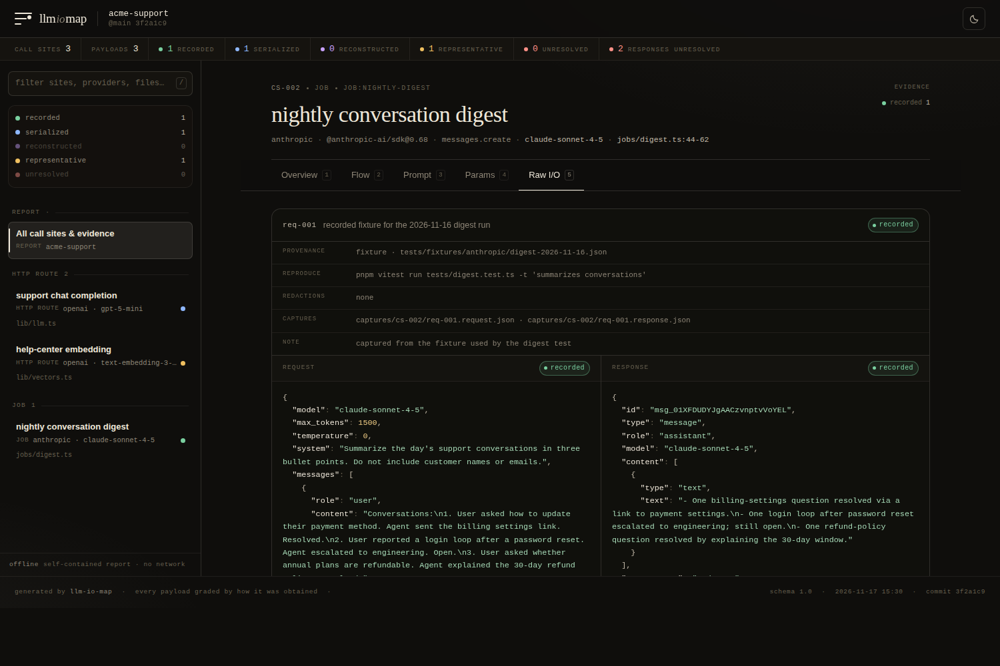

# llm-io-map

**An agent skill that maps every LLM call site in a codebase and reconstructs what actually goes in and out.**

Point your agent at a repo and it produces:

- **Where** every LLM is called — provider, SDK, model, file:line, wrapper, call chain.
- **When** it fires — HTTP route, cron, queue, webhook, CLI, with gating conditions.
- **What goes in and out** — system prompts, message templates, tools, model params, and the raw request/response payloads.
- **How much to trust each payload** — every capture is graded by how it was obtained.
- **A viewer anyone can open** — a single offline HTML file, no server, no dependencies.

```
.llmmap/
  manifest.json      # the map: call sites, flow, payloads, evidence grades
  report.html        # self-contained viewer; open it in any browser
  captures/          # verbatim request/response pairs (secrets redacted)
  extract/           # repo-tailored discovery + harness scripts, re-runnable
  README.md          # refresh instructions and known gaps
```



## Why it exists

Static analysis can tell you *where* an LLM is called. Runtime tracing can tell you *what* was sent — but only for traffic you happened to record. This skill does both, honestly: it finds recorded evidence first, reconstructs or serializes requests from the real code path when it can, and **labels every payload with a grade instead of pretending everything is raw**.

Most "map the LLM usage" prompts give you a plausible-looking report with invented example payloads. This skill forbids that. A map with honest gaps is the deliverable; a complete-looking fiction is a failure.

### Evidence grades

| Grade | Meaning |
|---|---|
| `recorded` | A real request/response already exists in the repo (fixture, cassette, snapshot, eval dataset, log) |
| `serialized` | Exact request the SDK would send, captured by running the real path against a stub |
| `reconstructed` | Exact for a stated input, derived statically from the code path |
| `representative` | Shape + example for dynamic inputs; explicitly not a capture |
| `unresolved` | Not obtainable; reason and what would unblock it are recorded |

Every payload carries provenance, a reproduce command, redactions applied, and the concrete input it represents.

## Install

```bash
npx skills add haroon0x/llm-io-map
```

Works with Claude Code, Cursor, Codex, Windsurf, Gemini, GitHub Copilot, and any agent that supports the [Agent Skills](https://skills.sh/) format. Or clone this repo and copy `SKILL.md`, `references/`, `assets/`, `scripts/` into your agent's skills directory.

## Use

Ask your agent:

> Map the LLM usage in this repo and build the I/O report.

or invoke the skill directly by name: `llm-io-map`.

The agent will:

1. Profile the repo (stack, runnable, existing recorded evidence).
2. Enumerate call sites across provider SDKs, frameworks, raw HTTP, gateways, agent loops, and non-chat calls (embeddings, moderation, …).
3. Climb the evidence ladder per call site — recorded → serialized (harness) → reconstructed → representative → unresolved.
4. Write `.llmmap/manifest.json` and render `.llmmap/report.html`.
5. Verify coverage, redaction, and viewer integrity before reporting back.

Browse [`examples/report.example.html`](examples/report.example.html) for a rendered sample (open locally in a browser), and [`assets/manifest.example.json`](assets/manifest.example.json) for the data contract.

## What it refuses to do

- Invent payloads to fill gaps.
- Present a reconstructed or representative payload as a capture.
- Hit a live model API without explicit approval.
- Leak secrets into the report (`scripts/redact.py` scans captures and inline payloads).
- Silently omit a call site. Every candidate is resolved or explicitly blocked with a reason.

## Repo layout

```
SKILL.md                        # the skill: procedure + evidence rules
references/
  discovery-checklist.md        # where LLM calls hide (full surface matrix)
  evidence-ladder.md            # grade definitions, borderline cases, redaction
  harness-recipes.md            # capture recipes for Node/Python/Go/Rust/…
  manifest-schema.md            # manifest contract
  verification.md               # completion checklist
assets/
  viewer.html                   # single-file viewer template
  manifest.example.json         # complete example manifest
scripts/
  discover.sh                   # first-pass repo sweep
  redact.py                     # secret redaction + --check mode
  render.mjs                    # safe manifest → report.html renderer
examples/
  report.example.html           # rendered sample
  screenshot.png
```

## Limits

- Static analysis cannot see runtime values. Payloads dependent on live data (RAG results, DB rows, user context) are `representative` unless recorded or captured through a harness.
- Responses are only as good as the evidence: recorded > approved live call > unresolved.
- Framework internals (LangChain, Vercel AI SDK, gateways) can hide the serialization boundary; the skill tells you when it captured above it and grades accordingly.
- Third-party dependency internals are out of scope; the in-repo invocation is mapped.

## Contributing

Issues and PRs welcome — especially new harness recipes for stacks not yet covered, and discovery patterns for LLM surfaces that keep appearing in the wild.

## License

MIT
